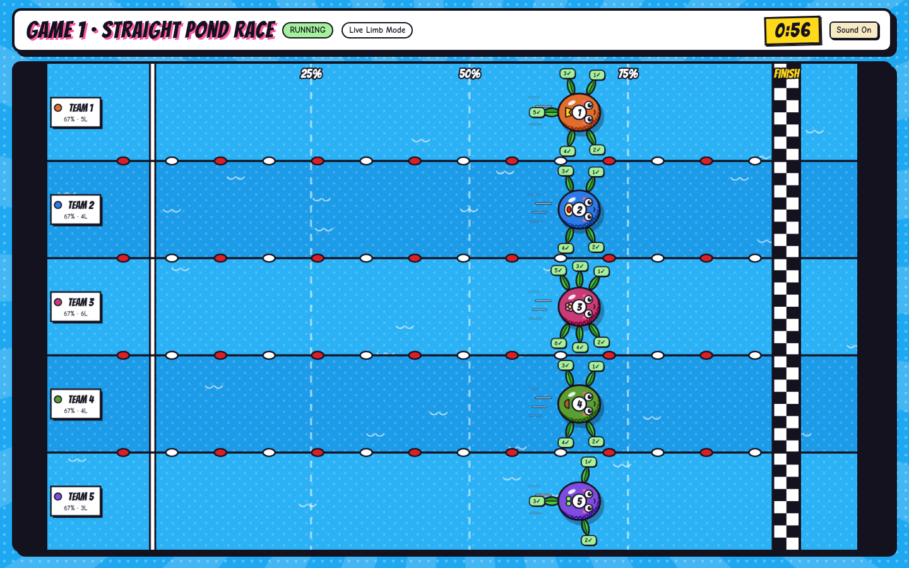
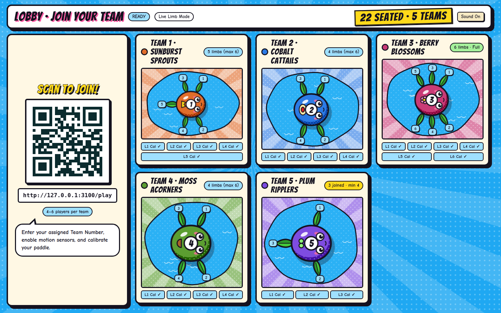
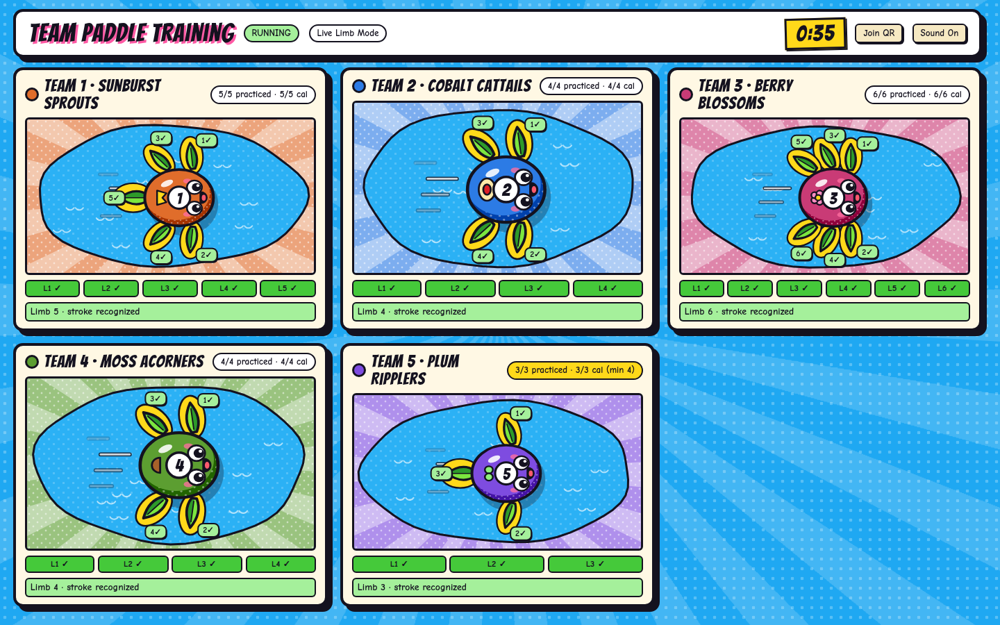

# Pond Game

A comic-style multiplayer game where a **team shares one swimming creature**. Each person holds a phone and paddles a single limb with a short seated sweep: hold, stroke, release. The rest of the room watches the shared display.

Teams of 4–6. At most 30 players. The phone recognizes the motion locally; the server owns the clock, scores, and seats.



## How it plays

1. Players join the team number they were given, enable motion, hold still to calibrate, then practice a few strokes.
2. The shared display shows each creature and which paddles are live, calibrated, or still learning.
3. A straight race down parallel lanes. An optional free-water round adds steering and collectibles.

A player keeps the same team, limb, and movement for the whole session. Disconnecting does not give the rest of the team extra power.



*Join from the projected QR code. Only teams that have players appear, and the layout resizes around them.*



*Training: each accepted stroke flashes on that paddle and leaves a checkmark, so you can see who still needs a hit.*

## Surfaces

| Route | Who | What |
| --- | --- | --- |
| `/play` | Players | Phone controller: join, calibrate, hold-to-paddle |
| `/screen` | The room | Read-only shared display (lobby, training, race, harvest) |
| `/control` | Host | Passcode-protected console for phases, seats, and recovery |
| `/lab` | Host / debug | Standalone sensor check, no game propulsion |

The shared display cannot issue host commands.

## Quick start

```bash
npm install
cp .env.example .env
npm run build
npm run typecheck
npm test
npm run dev
```

Then open:

- Players: `http://127.0.0.1:3000/play`
- Shared display: `http://127.0.0.1:3000/screen`
- Host console: `http://127.0.0.1:3000/control`

Phone motion APIs need a top-level **HTTPS** origin, so local `http://127.0.0.1` is fine on a laptop browser and not enough for real phones. For phones, put the server behind HTTPS (Caddy, Nginx with TLS, or a WebSocket-capable tunnel such as Cloudflare Tunnel). `npm run tunnel:quick` starts a Cloudflare Quick Tunnel to `http://127.0.0.1:3000`.

During UI work you can also run `npm run dev:client` (Vite on port `5173`, proxying `/socket.io` and `/api`).

## Host a session

1. Open `/control`, sign in with `HOST_PASSCODE`, and set the universal min/max team size (default 4–6). Teams are created as people join; you do not pre-build a roster.
2. Put `/screen` on the projector. Hand out team numbers. Players scan the QR code, enter that number, enable motion, calibrate, and practice.
3. Watch the readiness columns (online, sensor, calibrated, practiced) and help anyone who is stuck.
4. Load **Training**, start it, then load **Straight Swim Race** and start the round. Empty or uncalibrated seats warn you; you can override explicitly.
5. Optionally run a short free-water practice, then a scored harvest.

Useful recovery (none of these should be “clear the whole session” mid-game):

- **Release Hold** — unstick one held paddle
- **Recalibrate** — that phone only, same team/limb/gesture
- **Reset Practice** — clear practice checkmarks, keep seats
- **Reset Current Round** — positions, timer, and items, keep people
- **Clear Entire Session** — evicts everyone; needs explicit confirmation

Restarting the Node process also wipes the in-memory session. Phone reconnects during a live session resume the same seat.

## Configuration

Copy [`.env.example`](.env.example) to `.env` (never commit `.env`):

| Variable | Purpose |
| --- | --- |
| `PORT` / `HOST` | Local bind address (default `127.0.0.1:3000`) |
| `HOST_PASSCODE` | Mission Control sign-in; required when `NODE_ENV=production` |
| `PUBLIC_BASE_URL` | HTTPS origin printed on the join QR code |
| `ENABLE_DEV_SIM` | Keep `false` for real sessions so synthetic test buttons stay hidden |

A systemd unit template lives at [`deploy/cs260b-pond-game.service.example`](deploy/cs260b-pond-game.service.example).

## Development

Tested on Linux (`7.0.0-43-generic`) with Node.js `v22.22.1` and npm `9.2.0`.

Pinned runtime: `express@4.21.2`, `socket.io@4.8.1`, `socket.io-client@4.8.1`, `react@19.0.0`, `react-dom@19.0.0`, `qrcode@1.5.4`, `@fontsource/bangers@5.3.0`, `@fontsource/comic-neue@5.3.0` (fonts are bundled; no font CDN).

Pinned toolchain: `typescript@5.7.3`, `vite@6.2.0`, `vitest@3.0.7`, `tsx@4.19.3`.

```bash
npm test
npm run rehearse:load
```

`npm test` covers recognizer rejections, seat caps, reconnect, stroke dedup, pause/resume freshness, limb-count propulsion, disconnect power, and the two network presentation modes awarding the same propulsion. The load rehearsal measures 30 player sockets plus host and display.

### Known limits

- Real iPhone Safari and Android Chrome sensor behavior still needs to be tuned on device. Synthetic traces are not physical-phone proof. `/play` can expose labeled **Directional Tilt** and **Touch Swipe** fallbacks if a handset cannot do linear sweeps.
- iPhone Safari does not give web pages general Taptic Engine access. Essential state is always visual; haptics and audio are optional.
- Creatures, water, and UI chrome are procedural comic art (Canvas + CSS), not final illustrated assets.
- Session state lives in server memory.

Implementation details: [`CS260B_Pond_Game_Implementation_Spec.md`](CS260B_Pond_Game_Implementation_Spec.md).
